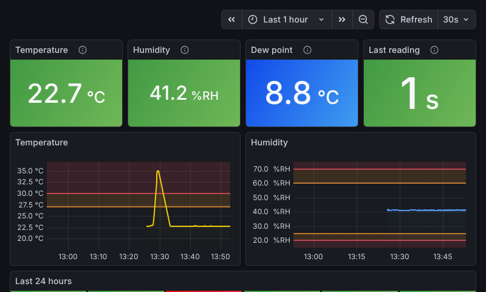
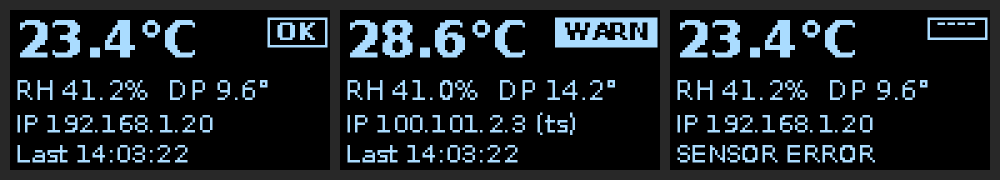

# Server Room Monitor

Temperature and humidity monitoring for a server room on a Raspberry Pi 4B:
a Sensirion SHT45 sensor, a local status screen, secure remote access over
Tailscale, and alerts to Telegram, email or Slack/Teams/Discord when thresholds
are crossed or the data stops.

```
SHT45 ──I2C──▶ collector (Python, systemd) ──▶ InfluxDB 2.x ──▶ Grafana
                  │  validation, dew point,        30 d raw        ├─ 7" touch display / HDMI kiosk
                  │  local buffer, watchdog        2 y 5-min       ├─ HTTPS on your tailnet (Tailscale)
                  ├─▶ SSD1306 OLED (optional)                      └─ alerts ─▶ Telegram / email / webhook
                  └─▶ heartbeat ─▶ healthchecks.io  (alerts you if the Pi itself dies)
```



Designed to run unattended for years: every component restarts itself, the
collector buffers data while InfluxDB is down, the hardware watchdog reboots a
hung Pi, and an external heartbeat tells you when the Pi stops reporting at all.
See [docs/architecture.md](docs/architecture.md) for the reasoning behind the design.

**Contents:**
[Parts](#parts-list) ·
[Wiring](#wiring) ·
[Placement](#sensor-placement) ·
[Install](#installation) ·
[Notifications](#notifications) ·
[Tailscale](#remote-access-with-tailscale) ·
[Display](#local-display) ·
[Thresholds](#changing-thresholds-and-other-settings) ·
[Operations](#day-to-day-operations) ·
[Troubleshooting](#troubleshooting) ·
[Hardware test status](#what-has-and-hasnt-been-tested)

---

## Parts list

| Part | Notes |
|---|---|
| Raspberry Pi 4 Model B, 4 GB | 2 GB works too; 4 GB leaves headroom for Chromium |
| Official Raspberry Pi USB-C power supply (5.1 V, 3 A) | Under-powered supplies cause random I2C and USB-SSD errors |
| USB 3 SSD (any size ≥ 32 GB) + UASP enclosure | Far more durable than an SD card for 24/7 writes. Boot from it via `raspi-config` → Advanced → Boot Order |
| Case with passive cooling (e.g. Flirc, Argon NEO) | Keep the Pi's own heat away from the sensor |
| **Sensirion SHT45 breakout**, e.g. Adafruit 5665 (STEMMA QT) | ±0.1 °C / ±1 %RH. SHT31 (Adafruit 2857) and BME280 (Adafruit 2652) also supported |
| *or, to get started:* **KY-015** (DHT11) or a DHT22/AM2302 module | Works, but much coarser; see [KY-015 / DHT11](#ky-015--dht11-dht22) |
| STEMMA QT / Qwiic to female jumper cable, e.g. Adafruit 4397 (150 mm) or 4209 | Or four female–female Dupont wires |
| Optional: longer cable or I2C extender | Plain I2C is reliable to roughly 1 m. For the rack front 2–5 m away, use a differential extender (e.g. SparkFun QwiicBus, PCA9615-based) |
| Display, one of: official Raspberry Pi 7" Touch Display (v1 800×480 or Touch Display 2), any HDMI monitor, or an SSD1306 128×64 I2C OLED (0x3C) | Or none |
| Optional: UPS (network-managed via NUT, or a UPS HAT) | See [UPS](#ups-optional) |

## Wiring

All sensors are 3.3 V I2C devices. **Use 3.3 V (pin 1), not 5 V.**

| Sensor pin | Pi header pin | Function |
|---|---|---|
| VIN / VCC | **1** | 3.3 V |
| GND | **6** | Ground |
| SDA | **3** | GPIO2 / I2C1 SDA |
| SCL | **5** | GPIO3 / I2C1 SCL |

```
         Raspberry Pi 4 GPIO header (top-left corner, USB ports pointing down)

                       ┌─────────┐
     SHT45 VIN ──── 3V3│ (1) (2) │5V
     SHT45 SDA ── GPIO2│ (3) (4) │5V
     SHT45 SCL ── GPIO3│ (5) (6) │GND ──── SHT45 GND
                       │ (7) (8) │
                       │  ...    │

     STEMMA QT colours:  red = VIN   black = GND   blue = SDA   yellow = SCL
```

The **OLED** goes on the same four pins (I2C is a bus): wire its VCC, GND, SDA
and SCL in parallel with the sensor, or daisy-chain STEMMA QT boards. The SHT45
answers at 0x44, the OLED at 0x3C. Most breakout boards already have pull-up
resistors; don't add more.

### KY-015 / DHT11, DHT22

The KY-015 is a DHT11 on a small board. It uses its own single-wire protocol on
a GPIO pin, **not I2C**, so it is wired differently:

| KY-015 pin | Pi header pin | Function |
|---|---|---|
| **S** (signal) | **7** | GPIO4 (data) |
| middle pin (**+**/VCC) | **1** | 3.3 V |
| **−** | **9** | Ground |

```
                       ┌─────────┐
    KY-015 + ─────  3V3│ (1) (2) │5V
                  GPIO2│ (3) (4) │5V
                  GPIO3│ (5) (6) │GND
    KY-015 S ──── GPIO4│ (7) (8) │
    KY-015 − ────── GND│ (9) (10)│
                       └─────────┘
```

- **Power it from 3.3 V, never 5 V.** The module has a pull-up resistor from the data line to VCC, so 5 V would put 5 V on the Pi's GPIO and can damage it.
- Check the labels on your board: pin order differs between KY-015 clones.
- Configure it:
  ```yaml
  sensor:
    model: dht11      # or dht22 for a DHT22/AM2302
    gpio: 4           # BCM number; 4 = header pin 7
  ```
  The installer adds `dtoverlay=dht11,gpiopin=4` to `/boot/firmware/config.txt`. Linux's own `dht11` driver then handles the timing-critical protocol, which Python can't do reliably, and **a reboot is needed** before the first reading.
- **Limits of the DHT11:** ±2 °C and ±5 %RH accuracy, a 0–50 °C and 20–90 %RH range, and individual reads fail now and then (the collector retries). With ±2 °C, a 27 °C warning can trigger anywhere from about 25 to 29 °C real. It's fine for getting the system running and spotting trends; for dependable alerts, switch to an SHT45 later. That's a config change plus rewiring, and the data stays.
- **Humidity alerts near the bottom of the DHT11 range:** below 20 %RH the DHT11 stops being meaningful, so the *Humidity low (critical)* alert at 20 % is unreliable with this sensor.
- The OLED still uses I2C (pins 3/5) and works alongside a DHT sensor.

The **official 7" touch display** connects to the DSI ribbon port and takes its
power from the 5 V pins (2/4) and GND; this does not conflict with the sensor.

## Sensor placement

What matters for the equipment is the air it **breathes in**, so measure that:

- **Front of the rack, at an air intake** (the cold aisle if you have one), not the back: exhaust air is 10–20 °C hotter and says nothing about cooling.
- **Mid-height** of the rack. The bottom is usually coolest and the top warmest; one sensor in the middle is the best single sample. (ASHRAE recommends top, middle and bottom for full coverage.)
- About **5 cm in front of the intake**, freely in the airflow, not touching metal.
- **Away from AC vents and their direct airflow**: you want the room's air, not the AC output.
- **Away from the Pi and other heat sources**: a sensor taped to the Pi's case reads several degrees high. This is why the cable length matters (see parts list).
- Out of direct sunlight, and not next to a door or window.

The default thresholds follow the ASHRAE A1 recommended envelope for intake air:
18–27 °C, so warning above 27 °C and critical above 30 °C. For humidity, too low
means static discharge risk and too high means condensation and corrosion.
The dashboard also shows the **dew point**: if it gets anywhere near the temperature
of cold surfaces (AC coils, cold-aisle air), you have a condensation problem.

## Installation

### 1. Prepare the Pi

1. Flash **Raspberry Pi OS Bookworm 64-bit** (Lite is recommended for a kiosk; Desktop also works) to the SSD with Raspberry Pi Imager. In the imager settings, set a hostname (e.g. `serverroom`), a user, your SSH key, and the time zone.
2. Connect Ethernet, the sensor (and display), boot, and SSH in.
3. Update: `sudo apt update && sudo apt full-upgrade -y && sudo reboot`

### 2. Install

```bash
sudo apt install -y git
git clone https://github.com/stmous/ServerStatus.git
cd ServerStatus
sudo ./install.sh
```

The installer:

1. checks the OS (Bookworm), architecture (aarch64) and model (Pi 4);
2. copies the app to `/opt/serverroom-monitor` and creates a Python venv with the pinned dependencies;
3. creates `/etc/serverroom-monitor/config.yaml` from the [annotated example](config/config.example.yaml) and **offers to open it in an editor**: set at least `location`, `display.mode` and your notification channels;
4. generates passwords and tokens into `/etc/serverroom-monitor/secrets.env` (mode 600) and **prompts for the ones it can't generate** (Telegram token, webhook URL, SMTP password, heartbeat URL);
5. enables I2C, the hardware watchdog, NTP, a size-capped persistent journal and unattended *security* upgrades;
6. installs InfluxDB 2.x and Grafana from their official repositories (signing keys verified), creates the buckets, the downsampling task and least-privilege tokens;
7. installs Tailscale, the firewall rules, the kiosk or OLED output, the collector service and a daily backup timer;
8. runs `i2cdetect`, **refuses to finish until the sensor answers**, and prints a first reading.

It is idempotent: run it again after `git pull`, or to repair anything. Your
config and secrets are never overwritten. Options: `--non-interactive`,
`--skip-sensor-check` (finish without a sensor connected), `--force`.

### 3. Reboot and finish

```bash
sudo reboot                                   # activates watchdog + kiosk
sudo tailscale up                             # see "Remote access" below
sudo /opt/serverroom-monitor/scripts/apply-config.sh
sudo /opt/serverroom-monitor/scripts/test-alerts.sh
```

## Notifications

Enable any combination in `config.yaml` under `notifications:`, put the secret
in `secrets.env`, then run `sudo /opt/serverroom-monitor/scripts/apply-config.sh`.
Every alert sends a **resolved** message when it clears.

| Alert | Severity | Condition (defaults) |
|---|---|---|
| Temperature high | warning / critical | > 27 °C / > 30 °C for 2 min |
| Humidity low | warning / critical | < 25 % / < 20 % for 2 min |
| Humidity high | warning / critical | > 60 % / > 70 % for 2 min |
| No data from sensor | critical | last reading older than 3 min (also fires if InfluxDB is unreachable) |
| Sensor error | critical | collector can't get valid readings (I2C errors, implausible values) for 3 cycles, plus 2 min |

Warnings repeat every 4 h, critical alerts every hour, until resolved.

### Telegram

1. In Telegram, open a chat with **@BotFather**, send `/newbot`, and follow the prompts. It replies with a **token** like `123456789:AAH...`.
2. Decide where alerts go:
   - **Directly to you:** open a chat with your new bot and send it any message.
   - **To a group:** add the bot to the group, then send a message in the group that mentions it (`@yourbot hello`).
3. Find the **chat ID**. Open this URL in a browser (with your token):
   `https://api.telegram.org/bot<TOKEN>/getUpdates`
   and look for `"chat":{"id":...}`. Private chats have a positive number; groups have a negative one, and supergroups start with `-100`.
4. Configure:
   ```yaml
   # config.yaml
   notifications:
     telegram:
       enabled: true
       chat_id: "-1001234567890"
   ```
   ```bash
   # secrets.env
   TELEGRAM_BOT_TOKEN='123456789:AAH...'
   ```

### Email (SMTP)

Set `notifications.email` in the config (server, port, from address, recipients)
and `SMTP_PASSWORD` in secrets. For Gmail and Microsoft 365, use an
**app password**, not your normal password. Port 587 uses `starttls: mandatory`;
for implicit TLS on port 465, use `starttls: none`.

### Webhook: Slack, Teams, Discord or generic

Set `notifications.webhook.type` to `slack`, `discord`, `teams` or `generic`,
and put the incoming-webhook URL in `WEBHOOK_URL`. `generic` POSTs Grafana's
standard webhook JSON, which works for n8n, Home Assistant, ntfy and similar.
For Teams, create the webhook URL with the **Workflows** app ("Post to a channel
when a webhook request is received").

### Heartbeat (dead man's switch), strongly recommended

Grafana can only alert while the Pi is alive. To get told when the Pi dies,
loses power or loses its network:

1. Create a free check at [healthchecks.io](https://healthchecks.io) with **period 1 minute, grace 5 minutes**, and connect it to your phone, email or Telegram.
2. Put its ping URL in `secrets.env`: `HEARTBEAT_URL='https://hc-ping.com/<uuid>'`.

The collector pings after every good reading and pings `/fail` while the sensor
is failing. Optionally set `notifications.deadman.enabled: true` with a second
check's URL in `DEADMAN_URL`: Grafana then pings it every 5 minutes, which
catches a broken alerting pipeline as well.

### Testing notifications

```bash
sudo /opt/serverroom-monitor/scripts/test-alerts.sh           # through Grafana (what real alerts use)
sudo /opt/serverroom-monitor/scripts/test-alerts.sh --direct  # straight to Telegram/SMTP/webhook
```

Each channel reports `[ OK ]` or `[FAIL]` with the reason. To trigger a *real*
alert end to end, see [Testing without hardware](#testing-without-hardware).

## Remote access with Tailscale

Nothing is exposed to the internet and no port forwarding is needed. Grafana
listens on localhost only; Tailscale gives your devices an encrypted path to it,
with a real HTTPS certificate.

**On the Pi:**

```bash
sudo tailscale up            # open the printed URL and log in
```

Then, in the [Tailscale admin console](https://login.tailscale.com/admin):

1. **DNS** → enable **MagicDNS** and **HTTPS Certificates**.
2. **Machines** → the Pi → `…` → **Disable key expiry**. Otherwise it drops off the tailnet after 180 days.

Then run `sudo /opt/serverroom-monitor/scripts/apply-config.sh`. It sets up
`tailscale serve` and prints the address: **`https://serverroom.<your-tailnet>.ts.net/`**.
(For an unattended install, put a pre-authorized key in `TAILSCALE_AUTHKEY` and
the installer runs `tailscale up` for you.)

**On your phone:** install **Tailscale** from the App Store or Google Play, sign in
with the same account, switch it on, and open the address above. The dashboard
is laid out for phones. To keep it one tap away, add it to your home screen.

**From a laptop on the LAN** without Tailscale: set `grafana.lan_access: true`
(plain HTTP on port 3000, allowed from your LAN subnets only).

## Local display

Set `display.mode` in `config.yaml`, then run `apply-config.sh` and reboot.

### `hdmi`: 7" touch display or HDMI monitor

Chromium shows the dashboard full-screen. It uses a **read-only shared dashboard
link**, so the screen needs no login and can't be used to change anything. The
first screen (current values, 24 h graphs) is designed to fit 800×480 exactly;
swipe up for the 24 h min/max/average, collector health and active alerts.

- On **Lite**, a minimal `cage` compositor runs on tty1 (`serverroom-kiosk.service`).
- On **Desktop** (labwc, wayfire or X11), Chromium autostarts in the desktop session of an auto-logged-in `kiosk` user.
- The cursor is hidden, pinch-zoom and swipe-back are disabled, Chromium restarts if it crashes and once a day at 04:00, and screen blanking is off. Set `display.hdmi.screen_blanking: true` and `blank_after` to change that.
- `display.hdmi.night: "22:00-07:00"` and `night_brightness` dim the DSI display's backlight at night.
- **Rotation:** `display.hdmi.rotation` (0/90/180/270) applies on Lite/cage. On Desktop, use *Screen Configuration*. For **Touch Display 2** (native portrait), you can instead rotate at boot by adding `dtoverlay=vc4-kms-dsi-ili9881-7inch,rotation=90` to `/boot/firmware/config.txt`.
- With the official 7" v1 display upside down in its case, use `rotation: 180`.

### `oled`: SSD1306 128×64



Shows temperature, humidity, dew point, a local OK/WARN/CRIT badge, the IP
address (alternating LAN and Tailscale), and the time of the last reading or
`SENSOR ERROR`. To prevent burn-in, the image shifts by a pixel each update;
`display.oled.night` dims or switches it off at night.

## Changing thresholds and other settings

All settings live in `/etc/serverroom-monitor/config.yaml` (annotated). Thresholds
drive the Grafana alert rules, the dashboard colors and threshold bands, and the
OLED badge, so they only need to be set in one place:

```bash
sudo nano /etc/serverroom-monitor/config.yaml
```
```yaml
thresholds:
  temperature:
    warning_high: 26
    critical_high: 29
  humidity:
    critical_low: 20
    warning_low: 30
    warning_high: 55
    critical_high: 65
  stale_after: 3m
  pending_period: 2m
```
```bash
sudo /opt/serverroom-monitor/scripts/apply-config.sh
```

`apply-config.sh` validates the file first. A typo produces an error naming the
exact key, and nothing changes. **Don't edit thresholds in the Grafana UI**:
provisioned rules are read-only there, and the config file is the source of truth.

## Day-to-day operations

| Task | Command |
|---|---|
| Collector status / live log | `systemctl status serverroom-monitor` · `journalctl -u serverroom-monitor -f` |
| Recent readings with fields | `journalctl -u serverroom-monitor EVENT=reading -o verbose -n 3` |
| One-off sensor check | `sudo /opt/serverroom-monitor/scripts/test-sensor.py` |
| Apply config/secret changes | `sudo /opt/serverroom-monitor/scripts/apply-config.sh` |
| Test notifications | `sudo /opt/serverroom-monitor/scripts/test-alerts.sh` |
| Backup now | `sudo /opt/serverroom-monitor/scripts/backup.sh` |
| Grafana admin password | `sudo grep GRAFANA_ADMIN /etc/serverroom-monitor/secrets.env` |

### Backup and restore

`serverroom-backup.timer` runs `scripts/backup.sh` daily at about 03:17. It saves
the config and secrets, the Grafana database and an InfluxDB backup to
`/var/backups/serverroom-monitor/` (keeping 7). **The archives contain secrets
(mode 600). Copy them off the Pi**, e.g. with `rsync` from another machine.

To restore onto a fresh install:

```bash
sudo tar -xzf serverroom-backup-XXXX.tar.gz -C /tmp/restore
sudo tar -xf /tmp/restore/config.tar -C /             # config.yaml + secrets.env
sudo ./install.sh                                      # reuses the restored secrets
sudo systemctl stop grafana-server
sudo cp /tmp/restore/grafana.db /var/lib/grafana/grafana.db && sudo chown grafana: /var/lib/grafana/grafana.db
sudo systemctl start grafana-server
INFLUX_TOKEN=$(sudo grep -Po "(?<=INFLUX_OPERATOR_TOKEN=')[^']*" /etc/serverroom-monitor/secrets.env) \
  influx restore /tmp/restore/influxdb --full
```

### Upgrading

- **This project:** `cd ServerStatus && git pull && sudo ./install.sh`
- **OS security updates** install automatically. Kernel updates need a reboot, which is not automatic; reboot during a quiet moment, or set `Automatic-Reboot "true"` in `/etc/apt/apt.conf.d/51serverroom-unattended-upgrades`.
- **Grafana and InfluxDB** are excluded from automatic upgrades because a major Grafana release can change provisioning behavior. Upgrade them deliberately: `sudo apt install grafana influxdb2`, then run `apply-config.sh` and `test-alerts.sh`.

## Testing without hardware

The collector has a simulator with scenarios that exercise every alert:

```bash
# On the Pi: stop the service and run a scenario by hand (Ctrl+C to stop).
sudo systemctl stop serverroom-monitor
sudo bash -c 'set -a; . /etc/serverroom-monitor/env/collector.env; exec runuser -u serverroom -- \
  /opt/serverroom-monitor/venv/bin/serverroom-monitor run --simulate overheat --sim-speed 10'
sudo systemctl start serverroom-monitor
```

(Or set `sensor.model: simulated` in the config and run `apply-config.sh` to
run the whole stack on fake data permanently.)

Scenarios: `normal`, `overheat` (+0.5 °C/min to 35 °C), `dry`, `humid`, `spikes`
(tests the spike filter), `flaky` (40 % I2C errors), `dead` (every read fails).
`--sim-speed 10` makes scenarios evolve ten times faster. `--dry-run` prints
InfluxDB line protocol instead of writing, so it needs no database at all:

```bash
PYTHONPATH=collector python3 -m serverroom_monitor -c config/config.example.yaml \
  run --simulate --dry-run --interval 2
```

## UPS (optional)

The Pi survives short power cuts only if it's on a UPS. Two ways to get a
clean shutdown before the battery runs out:

- **Network/USB UPS with NUT:** install `nut-client` and set `SHUTDOWNCMD "/opt/serverroom-monitor/system/ups/serverroom-ups-shutdown.sh"` in `/etc/nut/upsmon.conf`.
- **UPS HAT with a low-battery GPIO:** adapt and enable `system/ups/serverroom-ups-gpio.service` (GPIO number per your HAT), or point the vendor daemon at the same shutdown script.

The hook stops the collector, Grafana and InfluxDB cleanly, then powers off.
Scripts in `/etc/serverroom-monitor/hooks/low-battery.d/` run first, e.g. to send
a last message. A dying Pi stops the heartbeat, so you will also get the
healthchecks.io alert.

## Troubleshooting

### Sensor not detected

```bash
ls /dev/i2c-1                      # missing -> sudo raspi-config nonint do_i2c 0 && sudo reboot
sudo i2cdetect -y 1                # SHT4x/SHT31: 44 (or 45), BME280: 76/77, OLED: 3c
sudo /opt/serverroom-monitor/scripts/test-sensor.py
```

- **Empty grid:** check wiring, especially SDA/SCL swapped, VIN on 5 V instead of 3.3 V, or a loose Dupont connector. Reseat the cable at both ends.
- **Shows `45` instead of `44`:** some SHT31/SHT45 variants use 0x45. Set `sensor.i2c_address: 0x45`.
- **Detected, but reads fail intermittently (`[Errno 121] Remote I/O error`):** the cable is too long or noisy. Shorten it, use twisted pairs, keep it away from power cables, or use an I2C extender. The collector retries and reports `Sensor error` only when failures persist.
- **`[Errno 16] Device or resource busy`:** another program is using the sensor. That's normal while the collector runs; `test-sensor.py` still works because I2C is shared.
- **BME280 found at 0x76 but "Failed to find BME280! Chip ID 0x58":** that's a BMP280, which has no humidity sensor.

### DHT11 / KY-015 not reading

```bash
grep dht11 /boot/firmware/config.txt          # expect: dtoverlay=dht11,gpiopin=4
cat /sys/bus/iio/devices/iio:device*/name     # expect: dht11@4
sudo /opt/serverroom-monitor/scripts/test-sensor.py --count 5
```

- **No `dht11@…` device:** the overlay line is missing or you haven't rebooted since it was added.
- **Every read fails with `Connection timed out`:** the sensor isn't answering. Check the S pin is on the GPIO in `sensor.gpio`, that VCC goes to 3.3 V, and the pin order printed on your module.
- **Some reads fail with `Input/output error`:** that's a checksum error and normal for a DHT11. The collector retries; it only alerts when every attempt in 3 cycles in a row fails.
- **Readings look off by a couple of degrees:** that's within the DHT11's ±2 °C spec.

### No data in Grafana

```bash
systemctl status serverroom-monitor influxdb grafana-server
journalctl -u serverroom-monitor -n 50
```

- **Collector restarting with `INFLUX_WRITE_TOKEN is not set`:** run `sudo ./install.sh` again; it recreates tokens.
- **Log says `buffering locally`:** InfluxDB is down. Check `journalctl -u influxdb -n 50`. Points are kept on disk and written once it's back. The *Buffered points* panel shows the backlog.
- **`system clock is not set`:** no NTP yet. Check `timedatectl`; the Pi needs UDP 123 outbound.
- **Panels say "No data" but the collector logs readings:** in Grafana, open *Connections → Data sources → InfluxDB (server room) → Test*. If it fails, run `apply-config.sh` to rewrite the token, then `install.sh` if that doesn't help.
- **Stat panels say "No data" while the graphs show older data:** no reading in the last 15 minutes. The *No data from sensor* alert should already be firing.

### Alerts not arriving

1. Run `sudo /opt/serverroom-monitor/scripts/test-alerts.sh`. It shows each channel's error.
2. If that fails, run `test-alerts.sh --direct`. If *direct* works but *Grafana* fails, it's a Grafana configuration problem: check `journalctl -u grafana-server | grep -i -E "alert|notif"`.
3. **Telegram `chat not found`:** wrong chat ID, or the bot was never messaged or added to the group. **`Unauthorized`:** wrong token.
4. **Email:** use an app password; check port and `starttls`. Port 25 is often blocked by ISPs.
5. **No alert where you expected one:** look in Grafana → *Alerting → Alert rules*. A rule must stay above its threshold for `pending_period` (2 min) before it fires, and notifications are batched for `group_wait` (30 s).

### Kiosk not starting (7" display / HDMI)

```bash
grep -E 'mode|session' /etc/serverroom-monitor/config.yaml   # display.mode must be hdmi
systemctl status serverroom-kiosk                           # Lite / cage
journalctl -u serverroom-kiosk -b                           # or: journalctl -b | grep serverroom-kiosk
cat /etc/serverroom-monitor/generated/kiosk-url.env         # shared dashboard link
```

- **Black screen on Lite:** run `systemctl get-default`; it must be `graphical.target`. Re-run `apply-config.sh` and reboot.
- **cage fails with seat errors:** the `kiosk` user must be in the `video`, `render` and `input` groups (`id kiosk`). Re-run `apply-config.sh`.
- **Desktop shows the normal desktop:** the autologin user must be `kiosk` (check `grep autologin /etc/lightdm/lightdm.conf`), and `~kiosk/.config/autostart/serverroom-kiosk.desktop` must exist.
- **Grafana login page instead of the dashboard:** the shared link is missing. Re-run `apply-config.sh` and look for "kiosk uses shared dashboard link".
- **Touch input inverted after rotating:** see the rotation notes under [Local display](#local-display).
- To get a console on Lite, press `Ctrl+Alt+F2`.

### Lost InfluxDB operator token

If `secrets.env` was lost and there's no backup, the existing InfluxDB can't be
managed anymore. Reset it (this **deletes recorded data**):
`sudo systemctl stop influxdb && sudo rm -rf /var/lib/influxdb/* && sudo ./install.sh`.

## What has and hasn't been tested

This was built and tested **without a Raspberry Pi**:

**Verified** (automated tests, plus runs against real InfluxDB 2.8.0/2.9.1 and Grafana 12.3 on x86):

- the collector loop, validation, dew point, buffering through an InfluxDB outage, flush, watchdog notifications and SIGTERM;
- the InfluxDB setup script (fresh, rerun, lost secrets), least-privilege tokens, and that the downsampling Flux produces 5-minute mean/min/max;
- Grafana provisioning loads without errors;
- the full alert lifecycle: temperature warning and critical fired, no-data fired, resolved messages sent, delivered to a webhook, with the message text as documented;
- `test-alerts` through Grafana's API;
- the shared dashboard link, and the dashboard layout at 800×480 and phone width (Chromium screenshots);
- the OLED rendering;
- the blank cursor theme (loaded with libXcursor);
- shellcheck on every script.

**Not tested on hardware** (written to the documented behavior, but never run on a Pi). Please report problems:

- the I2C sensor drivers on real SHT45/SHT31/BME280 chips, the DHT11/KY-015 through the kernel driver (tested against a fake sysfs tree, matching the Raspberry Pi kernel source), and the SSD1306 output;
- `install.sh` end to end on Raspberry Pi OS (apt packages, `raspi-config nonint`, systemd hardening options with real I2C devices);
- the cage kiosk and desktop autostart on labwc/wayfire/X11, cursor hiding, rotation and touch, the 7" backlight sysfs paths;
- the hardware watchdog, ufw together with Tailscale, `tailscale serve`, and the UPS GPIO example;
- Telegram and SMTP delivery: their Grafana integrations were exercised, but no real bot or mail server was available.

## Repository layout

```
install.sh / uninstall.sh      installer (idempotent) / remover (--purge for data)
config/                        annotated config.example.yaml, secrets.env.example
collector/serverroom_monitor/  the Python package (collector, drivers, Grafana generator)
collector/tests/               pytest suite (mock sensor, fake InfluxDB, shell helpers)
grafana/                       rendered reference provisioning (generated, don't edit)
influxdb/                      setup.sh, downsampling task
systemd/                       service/timer units and drop-ins
kiosk/                         Chromium launcher, cage wrapper, desktop autostart, cursor theme
system/                        journald, watchdog, unattended-upgrades, firewall, UPS hook
scripts/                       apply-config, test-sensor, test-alerts, backup, setup-kiosk
docs/architecture.md           design decisions
```

## Development

```bash
python3.11 -m venv .venv && . .venv/bin/activate
pip install -r requirements-dev.txt
pytest                      # unit tests
ruff check . && ruff format --check . && mypy
shellcheck -x install.sh uninstall.sh scripts/*.sh influxdb/setup.sh kiosk/*.sh system/*.sh system/ups/*.sh
scripts/render-defaults.sh  # after changing the dashboard/alert generator
```

Runtime dependencies are pinned in `requirements.txt` (compiled for aarch64 /
CPython 3.11 with `uv pip compile`, see `requirements.in`).

License: MIT
